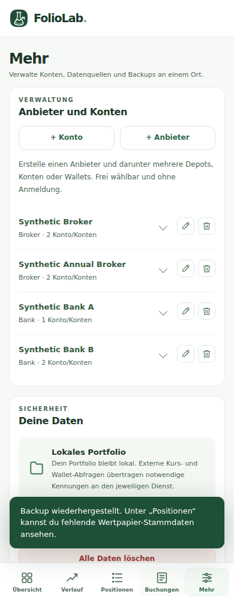

# FolioLab Open – Finaler Release und unabhängige Live-Abnahme

**PRODUKTIV ERFOLGREICH DEPLOYT** – sicherer beauftragter Umfang vollständig abgenommen am 25.10.2026.

- Produktion: https://joke0071.github.io/foliolab-open/
- Anwendungsrelease / tatsächlicher Merge-HEAD: `839b51e37b234cc4a7fe202eeb68118a786e0b78`.
- PWA-Cacheversion: `foliolab-open-v169`; 97 eindeutige Precache-Einträge, sämtliche `src/*.js` enthalten.
- [Vollständige main-CI und tatsächliches Pages-Deployment40198408959](https://github.com/joke0071/foliolab-open/actions/runs/40198408959): `test`, `cross-engine`, `deploy` erfolgreich, Homepage/SW nach Veröffentlichung verifiziert.
- [UI07-PR-CI40197890130](https://github.com/joke0071/foliolab-open/actions/runs/40197890130) und [Wallet40197890116](https://github.com/joke0071/foliolab-open/actions/runs/40197890116) ebenfalls erfolgreich.

## Paketabnahme

| Paket | Status | PR / integrierter Commit | Tatsächliche Tests | Merge / Deployment | Nächster Schritt |
| --- | --- | --- | --- | --- | --- |
| FLH01 | ABGESCHLOSSEN | [#137](https://github.com/joke0071/foliolab-open/pull/137), `91f83909e6453de40ef7a4be21477eb7864e01e5` | CI40189609001: 604/604, alle drei Engines, 245 Käufe + vier Korrekturen, Nullmutationen | In main und v169 enthalten | Keiner |
| IndexedDB B | ABGESCHLOSSEN im sicheren Umfang | [#138](https://github.com/joke0071/foliolab-open/pull/138), `c422dbd8e532127f738b24e07a9e5092fd865d84` | CI40190283807: 604/604, alle Engines; Migration/Backup/CAS/Recovery | In main und v169; nötige technische Recovery erhalten | Nur externe reale Gates #44 separat |
| AT03-B | ABGESCHLOSSEN | [#139](https://github.com/joke0071/foliolab-open/pull/139), `26a2460f7640464b323de8a031599f76c17bd680` | CI40191726918: 617/617, alle Engines, Split/Consent/Undo/Reimport/Restore/CAS | In main und v169 enthalten | AT03-C nur nach Realbelegen |
| AT05-A | ABGESCHLOSSEN | [#140](https://github.com/joke0071/foliolab-open/pull/140), `ad1d966ec98dff9eafba00dc262af0f5ad7ee894` | CI40194079825: 627/627, alle Engines, belegte Jahres-/Kontenfilter/Nullmutationen | In main und v169 enthalten | AT05-B nur nach Belegen/Fachvalidierung |
| AT01 | ABGESCHLOSSEN | [#141](https://github.com/joke0071/foliolab-open/pull/141), `8348a42c9d3bbd147a255b4730d7fe28e02fb476` | CI40195398684: 633/633, alle Engines, Dedupe/Filter/Aktion/Reparatur/Nullmutationen | In main und v169; #125 abgeschlossen | Keiner |
| AT04 | ABGESCHLOSSEN, No-Code | [Audit #128](https://github.com/joke0071/foliolab-open/issues/128#issuecomment-6398005023), geprüft auf `8348a42c9d3bbd147a255b4730d7fe28e02fb476` | 133/133 fokussierte Unit-Tests, acht tatsächliche Chromium-Suites; LST-/Restore-Proben; Capabilities bestätigt | Bestehende Implementierung vollständig erhalten; kein künstlicher PR, #128 abgeschlossen | Keiner im freigegebenen Delta |
| UI07 | ABGESCHLOSSEN | [#142](https://github.com/joke0071/foliolab-open/pull/142), `839b51e37b234cc4a7fe202eeb68118a786e0b78` | 633/633, Syntax, alle Engines; je 66 UI07-Scans ohne Befund, sechs Breiten, Dialogfokus, 200%-CSS-Zoom, 20 unveränderte visuelle Referenzen | In main und v169 enthalten | Keiner |
| FINAL-GATE | ABGESCHLOSSEN für Anwendungsrelease | Kein weiterer Funktions-PR; `839b51e37b234cc4a7fe202eeb68118a786e0b78` | main40198408959 komplett grün; eigenständiger Live-Test: 98 Hashes, 18 Axe-Scans, echte UI-Backups/Restore, Offline-Speichern | Tatsächliches Pages-Deployment und Live-Abnahme bestanden; null offene Auftrags-PRs | Reinen Abschlussdokumentations-HEAD ebenfalls prüfen und in #124 quittieren |

## Kombinierte Quality-Gates auf tatsächlichem main

633/633 Node-Tests, keine Fehler/übersprungenen Tests, `npm run check`. Sämtliche Browsersteps laufen fail-fast: kein nachfolgender erfolgreicher Test verdeckt einen vorherigen Fehler. Vollständige Chromium-Suites sowie Firefox/WebKit einschließlich UI07, Konten/Positionen, ETF-/Wallet-Historien, Finanzjournal/Cashflows/Flatex, Transfermatching, Jahresübersicht, Datenqualität, Festgeld/Zinsszenarien, unverschlüsselter/verschlüsselter Backups, v1/v2/v3-Migration, IndexedDB-CAS/Mehrtab/Quota/Recovery, PWA/Offline und Security-Canaries tatsächlich bestanden. 20 visuelle Dialogreferenzen mit 256 räumlichen RGB-Stichproben pro Bild und exakten Abmessungen unverändert. UI07 umfasst reduzierte Bewegung und gerenderten 200%-CSS-Zoom; dies ist kein physischer OS-/Browserzoom-Test.

[Synthetische Chromium-Gateartefakte](https://github.com/joke0071/foliolab-open/actions/runs/40198408959/artifacts/12601120580), [Firefox/WebKit-Gateartefakte](https://github.com/joke0071/foliolab-open/actions/runs/40198408959/artifacts/12601115197), [Dialog-Visuals](https://github.com/joke0071/foliolab-open/actions/runs/40198408959/artifacts/12601075579). Drittanbieter-Live-Probes dokumentieren auch derzeitige Erreichbarkeits-/CORS-Grenzen; daraus wird keine verifizierte Vollabdeckung aller Provider behauptet.

## Unabhängige tatsächliche Produktionsabnahme

Ausgeführt mit Playwright Chromium in neuen isolierten Browserprofilen, ausschließlich synthetische Konten/Positionen/Buchungen/Historien, keine privaten Backups oder echten Schlüssel. Die App-Dateien wurden unmittelbar von der öffentlichen Produktions-URL geladen; keine lokale App und keine ersetzten Produktionsantworten. Externe Kurs-/Blockchainanfragen sind im Smoke blockiert, da hier die veröffentlichte App und belegte lokale Daten geprüft werden; echte Providerkapazität wird dadurch nicht behauptet.

1. **Assetidentität:** 97 Precache-Ressourcen plus `sw.js`, insgesamt **98 exakte SHA-256-Übereinstimmungen** mit dem getesteten Checkout. Separate HTTP-Requests mit Releasekennung umgehen Browser-/SW-Caches. Zusätzlich tatsächlich vom Browser geladene App-/CSS-/Modulantworten bytegenau verglichen. Alle Hashes stehen im [versionierten JSON-Nachweis](release-evidence/v169-live-acceptance.json).
2. **Echte Schreib-/UI-Pfade:** Anbieter/Konto/ETF über den Assistenten erstellt, Position im bestehenden Editor geändert, IndexedDB-Speicherung und Reload geprüft. Frische Installation ohne lokales Portfolio-Mirror.
3. **Kombinierte Bedienung:** Alle fünf Tabs bei 320/390/1440px, belegte ETF-Buchungshistorie und gespeicherte synthetische Kryptohistorie, Buchungen, Jahresfilter, Datenqualität und Split-Transfer-Vorschau; Dialogschließen/Fokusrückgabe. **18 tatsächliche Axe-Scans ohne Befund**, keine Seitenüberläufe.
4. **Echte Downloads und Wiederherstellung:** Unverschlüsseltes JSON über UI heruntergeladen und in frischem Profil über UI wiederhergestellt; exakt erhaltene Buchungen nach Reload. Verschlüsseltes vollständiges Backup mit expliziter Historien-/Einstellungswahl ebenfalls tatsächlich heruntergeladen und per Passwort/Bestätigung in weiterem frischem Profil wiederhergestellt; Historie, Einstellungen und Buchungen erhalten. Der normale Klartext-Export enthält absichtlich keine Historien-/Schlüsselvollsicherung.
5. **PWA/Offline:** Tatsächlich aktiver Service Worker, explizite Updateprüfung und genau ein aktueller FolioLab-Cache v169. Netzwerk offline geschaltet, reale App neu geladen, Positionen/Buchungen geöffnet, Anbieter offline gespeichert und nach erneutem Reload nachgewiesen. Lokale Update-Suite prüft zusätzlich Altversion/aktive Editoren. Kein nativer Android-/physischer Installationsnachweis behauptet.

Reproduzierbare manuelle Testhilfe: `RELEASE_SHA=839b51e37b234cc4a7fe202eeb68118a786e0b78 node tests/browser-live-acceptance.mjs` im passenden Checkout (Playwright 1.56.1, axe-core 4.10.3). Ohne `ACCEPTANCE_BASE` wird ausschließlich die öffentliche Produktions-URL geprüft. Der vorherige lokale Trockenlauf war kein Produktionsnachweis. In dieser Laufzeit benötigt Chromium für den vorgeschalteten HTTPS-Inspektionsproxy eine Zertifikatsausnahme; TLS-Zertifikatsvalidierung wird daher nicht als eigener geprüfter Sicherheitsnachweis ausgegeben. App-CSP/Assertions bleiben unverändert.

## Unverändert offene externe Gates

#44: echte Android/TalkBack-/Safari-Hardware, Drive-Neugerät, physischer Crash/Eviction und Langzeit-Alttab-/Provider-Archivnachweise. Technisch notwendige Recovery-/Legacy-Kompatibilität deshalb erhalten, keine riskante Codeentfernung als abgeschlossen ausgegeben. AT03-C: freigegebene anonymisierte Broker-/Kontobelege. AT05-B: österreichische Steuer-/OeKB-Primärbelege und Fachvalidierung. #52: Barabfindungen/Kapitalmaßnahmen ohne belastbaren Fach-/Belegvertrag blockiert. Diese Themen liegen außerhalb des freigegebenen sicheren Paketumfangs und bleiben offen. Master #124 bleibt wegen dieser weiteren Themen offen; dies ist kein offener PR oder Releaseblocker dieses Auftrags.

## Dokumentationsabschluss und Wiederaufnahme

Dieser Bericht beschreibt den tatsächlich getesteten und live nachgewiesenen Anwendungsrelease oben. Sein nachfolgender Abschlusscommit enthält ausschließlich diesen Bericht, Checkpoints, synthetische Nachweise und die manuelle Testhilfe; keine ausgelieferten App-Dateien ändern sich. Auch auf diesem endgültigen Repository-HEAD muss die vollständige main-CI samt Pages-Deployment bestehen und der Live-Dateiabgleich wiederholt werden. Die abschließende Quittung mit genauem Dokumentations-HEAD und Run steht in [Master #124](https://github.com/joke0071/foliolab-open/issues/124). So bleibt die Identität des Anwendungsrelease von späterer Dokumentation unterscheidbar.

> Setze `FolioLab Open – Sequenzieller Abschluss der offenen Arbeitspakete` ab dem letzten verifizierten GitHub-Checkpoint fort. Prüfe aktuellen `main`, offene PRs und `docs/WORK_RESTPAKETE_CHECKPOINT.md`, überspringe abgeschlossene Pakete und beginne mit dem ersten offenen sicheren Teilschritt. Keine Wiederholung bereits abgenommener Arbeiten.
